# 📊 Tổng Hợp Thay Đổi & So Sánh Toàn Diện: `NKH-Studio:6.7` vs `NKH-Studio:7.0.0` (GMA Next-Gen SDK)

> [!IMPORTANT]
> Tài liệu này tổng hợp đầy đủ các thay đổi về **kiến trúc lõi**, **phiên bản thư viện Mediation/Bidding**, **cơ chế khởi tạo & đấu giá Real-Time Bidding**, **tính năng mới**, **hướng dẫn nâng cấp code ở tầng App**, cùng **số liệu đo kiểm thực tế (Release Build - Live Ads)** trên ứng dụng `The-Sun-IPTV-2`.

---

## 1. Bảng Đối Chiếu Phiên Bản Thư Viện (`NKH-Studio:6.7` vs `NKH-Studio:7.0.0`)

| Thành phần / Mạng Quảng Cáo | Bản cũ `NKH-Studio:6.7` | Bản mới `NKH-Studio:7.0.0` | Thay đổi chính |
| :--- | :--- | :--- | :--- |
| **Core Google Ads SDK** | `com.google.android.gms:play-services-ads:25.3.0` *(Legacy SDK)* | **`com.google.android.libraries.ads.mobile.sdk:ads-mobile-sdk:1.5.0`** *(GMA Next-Gen SDK)* | Chuyển sang kiến trúc **GMA Next-Gen** độc lập, loại bỏ nghẽn Main Thread khi khởi tạo |
| **Meta (Facebook) Mediation** | `com.google.ads.mediation:facebook:6.21.0.3` | **`com.google.ads.mediation:facebook:6.22.0.1`** | Nâng cấp Adapter & loại bỏ xung đột class `play-services-ads` cũ |
| **Facebook Android SDK** | `com.facebook.android:facebook-android-sdk:18.2.3` | **`com.facebook.android:facebook-android-sdk:18.3.0`** | Tối ưu thu thập Bidder Token |
| **AppLovin Mediation** | `com.google.ads.mediation:applovin:13.6.2.0` | **`com.google.ads.mediation:applovin:13.6.4.2`** | Nâng cấp Adapter tương thích GMA Next-Gen |
| **Liftoff (Vungle) Mediation** | `com.google.ads.mediation:vungle:7.7.4.0` | **`com.google.ads.mediation:vungle:7.7.8.1`** | Tối ưu khởi tạo & lấy Bidding Signal |
| **Pangle (TikTok) Mediation** | `com.google.ads.mediation:pangle:8.0.0.5.0` | **`com.google.ads.mediation:pangle:8.3.0.4.0`** | Nâng cấp lên Pangle SDK 8.3 |
| **Mintegral Mediation** | `com.google.ads.mediation:mintegral:17.1.61.0` | **`com.google.ads.mediation:mintegral:17.1.81.1`** | Nâng cấp Mintegral Bidding Adapter |
| **Unity Ads & Mediation** | `unity-ads:4.18.1` / `mediation:unity:4.18.0.0` | **`unity-ads:4.21.0` / `mediation:unity:4.21.0.0`** | Nâng cấp Unity 4.21 |
| **IronSource Mediation** | `com.google.ads.mediation:ironsource:9.4.2.0` | **`com.google.ads.mediation:ironsource:9.6.1.0`** | Nâng cấp IronSource 9.6 |
| **Adjust SDK** | `com.adjust.sdk:adjust-android:5.7.0` | **`com.adjust.sdk:adjust-android:5.8.0`** | Nâng cấp Adjust Tracking Doanh thu/PaidEvent |
| **Google Play Billing** | `com.android.billingclient:billing:9.0.0` | **`com.android.billingclient:billing:9.0.0`** *(kèm Cache `isPurchased`)* | Bổ sung cơ chế lưu đệm trạng thái mua hàng vào `SharedPreferences` |

---

## 2. Thay Đổi Kiến Trúc Cốt Lõi Giữa `6.7` và `7.0.0`

```mermaid
flowchart TB
    subgraph V67["🔴 Bản Cũ: NKH-Studio 6.7 (Legacy GMA)"]
        A1["GlobalApp.onCreate() (Main Thread)"] --> A2["MobileAds.initialize() chạy trên Main Thread<br/>(Khóa UI 225ms – 650ms)"]
        A2 --> A3["Gọi loadSplashInterstitialAds / Banner / Native ngay lập tức"]
        A3 --> A4["Adapter Bidding (AppLovin/Vungle/Meta) chưa init xong<br/>➡️ Mất Bid Token hoặc trượt NO_FILL (code=3) ở lần mở đầu"]
    end

    subgraph V700["🟢 Bản Mới: NKH-Studio 7.0.0 (GMA Next-Gen 1.5.0)"]
        B1["GlobalApp.onCreate() (Main Thread)"] --> B2["Đẩy MobileAds.initialize() sang Background Thread<br/>(Main Thread chỉ mất 18ms – 26ms)"]
        B2 --> B3["Smart Bidding Readiness Gate (Tối đa 2500ms)"]
        B3 --> B4["Đủ 100% Adapter READY ở ~1.1s – 2.1s<br/>➡️ Mở cổng ngay lập tức (hoặc cắt đúng 2500ms nếu có mạng treo)"]
        B4 --> B5["Phiên đấu giá đủ mặt 5 mạng Bidding<br/>➡️ Fill Rate 100% ngay từ lượt mở đầu tiên"]
    end
```



### 2.1. Khởi tạo Bất Đồng Bộ Không Chặn Main Thread (`Non-Blocking Background Init`)
- **Bản `6.7`:** Gọi `MobileAds.initialize(context)` trực tiếp trên **Main Thread** trong `GlobalApp.onCreate()`. Quá trình nạp lớp `DynamiteModule`, `WebView` provider và 7–10 Mediation Adapter khiến luồng UI bị đơ mất **`225 ms – 650 ms`**.
- **Bản `7.0.0`:** Toàn bộ `MobileAds.initialize()` được thực thi trên luồng nền chuyên biệt (`Thread(..., "NkhGmaNextGenInit")`) với cấu hình `InitializationConfig.Builder(admobAppId)`. Thời gian chiếm dụng Main Thread giảm xuống chỉ còn **`18 ms – 26 ms`** (**giảm `92.8%`**).

### 2.2. Cơ Chế Đấu Giá Thông Minh (`Smart Bidding Readiness Gate - 2500ms`)
- **Vấn đề ở bản `6.7`:** Các hàm `loadSplashInterstitialAds`, `loadBanner`, `loadNativeAd` bắn request lên AdMob ngay khi gọi hàm mà không kiểm tra xem các mạng Bidding (`AppLovin`, `Vungle`, `Meta`, `Mintegral`, `Pangle`) đã khởi tạo xong (`READY`) hay chưa. Ở lần mở app đầu tiên sau khi cài đặt (`Cold Install`), nhiều mạng Bidding cần `800ms – 1900ms` để init; việc bắn request quá sớm khiến các mạng này không kịp đóng gói `Buyer Token (Signal)` tham gia đấu giá, làm giảm eCPM hoặc gây trượt `NO_FILL (code=3)` (như đã ghi nhận thực tế ở `banner_splash_new` Lượt 1 trên `6.7`).
- **Giải pháp ở bản `7.0.0`:**
  1. Thiết lập cổng chờ thông minh `BIDDING_INIT_MAX_WAIT_MS = 2500L` kể từ lúc `GlobalApp.onCreate()` bắt đầu.
  2. **Nhả cổng sớm tự động (Early Release):** Khi callback `MobileAds.initialize` trả về (thường ở **`1159 ms – 2194 ms`** trên bản Release với ID thật) và tất cả Adapter đều báo `COMPLETE`, cổng chờ mở ngay lập tức mà không bắt người dùng đợi đủ `2500ms`.
  3. **Bảo vệ chống treo (Timeout Cap):** Nếu có 1 mạng quảng cáo cấu hình thiếu ID trên AdMob khiến adapter đó treo `30 giây`, cổng chờ sẽ tự động cắt ở đúng mốc **`2500ms`** để tiến hành đấu giá với các mạng đã sẵn sàng, tuyệt đối không làm chậm màn Splash.

### 2.3. Tối Ưu Google Play Billing (`AppPurchase`)
- **Bản `6.7`:** Mỗi lần mở app phải đợi kết nối dịch vụ `BillingClient` bất đồng bộ; nếu thiết bị không có Play Store hoặc mạng chập chờn có thể gây trễ luồng kiểm tra `isPurchased`.
- **Bản `7.0.0`:** Lưu đệm trạng thái `isPurchased` vào `SharedPreferences` ngay khi xác thực thành công và giải phóng luồng Splash tức thì nếu `BillingUnavailable`.

### 2.4. Công Cụ Kiểm Tra Quảng Cáo & Bidding Trực Tiếp Trên Màn Hình (`NkhAdDebugManager`)
- **Mới hoàn toàn trên `7.0.0`:**
  - Khi chạy bản **Debug** (tự động kiểm tra `ApplicationInfo.FLAG_DEBUGGABLE` + `isEnableDebugMode`), thư viện hiển thị nút nổi `🐞` gọn nhẹ trên màn hình (tự động ẩn hoàn toàn 100% trên bản **Release**).
  - Bấm vào mở bảng **Ad Debug Inspector** gồm 2 Tab:
    - **Tab 1 (`Ad Requests`):** Theo dõi thời gian thực từng vị trí quảng cáo đang `LOADING`, `LOADED`, `SHOWN` hay `FAILED`, thời gian tải (`ms`), tên mạng chiến thắng phiên đấu giá (`Mediation Adapter`) và doanh thu `eCPM`.
    - **Tab 2 (`Bidding Adapters`):** Hiển thị trạng thái `READY` / `NOT_READY` và độ trễ khởi tạo (`Latency ms`) của từng mạng Bidding.

### 2.5. Hỗ Trợ Đầy Đủ Các Định Dạng Quảng Cáo & Tùy Biến Mới
- **Parallel Splash Loading (Tải 3 luồng đồng thời ở Splash):** Hỗ trợ gọi song song `High-Floor` / `All-Price` / `Secondary` và tự động chọn quảng cáo có giá trị cao nhất phản hồi sớm nhất.
- **Dynamic Native CTA & Component Reordering:** Hỗ trợ đổi màu nút CTA (`colorCTA`), chiều cao nút (`heightCTA`), vị trí nút (`positionCTA = TOP / BOTTOM`) và thứ tự thành phần Native Ad từ Remote Config.
- **Định dạng nâng cao:**
  - `Collapsible Banner` (`TOP` / `BOTTOM`), `Anchored Adaptive Banner`, `Inline Adaptive Banner`.
  - `Fullscreen Native Ad` (giao diện vuốt dọc kiểu TikTok/Reels cho Onboarding).
  - `Swipeable In-Feed Interstitial`, `Rewarded Interstitial`, `Picture-in-Picture (PiP) Ad`.

---

## 3. Kết Quả Benchmark Thực Nghiệm Trên `The-Sun-IPTV-2` (Release Build - Live Ads)

> [!NOTE]
> - **Thiết bị đo:** Samsung Galaxy A23 5G (`SM-A236E`, Android 14, Serial `R5CW8186YCY`).
> - **Cấu hình Build:** `./gradlew installRelease` (`minifyEnabled true`, `shrinkResources true`, `ENVIRONMENT_PRODUCTION`).
> - **Bộ ID Quảng Cáo:** Bộ ID thật đang Active trên Firebase Remote Config (`*_new` thuộc tài khoản `ca-app-pub-7208941695689653~4201013198`).
> - **Quy trình:** Chạy **3 lượt Cold Start** độc lập (`adb shell am force-stop` trước mỗi lượt) cho mỗi phiên bản.

### 3.1. Bảng So Sánh Tốc Độ Khởi Tạo & Khởi Động App

| Chỉ số đo (Release Build) | `NKH-Studio:6.7` (T1 / T2 / T3) | **Trung bình `6.7`** | `NKH-Studio:7.0.0` (T1 / T2 / T3) | **Trung bình `7.0.0`** | Mức cải thiện (`7.0.0` vs `6.7`) |
| :--- | :---: | :---: | :---: | :---: | :--- |
| **`NKH_INIT_MAIN_THREAD_MS`** *(Thời gian khóa Main Thread khi init Ads)* | `339` / `313` / `225 ms` | **`292.3 ms`** | `18` / `19` / `26 ms` | **`21.0 ms`** | ⚡ **Nhanh gấp `13.9x` (`-92.8%`, giải phóng `271.3 ms` trên UI Thread)** |
| **`GLOBAL_APP_ONCREATE_MS`** *(Tổng thời gian `GlobalApp.onCreate()`)* | `533` / `504` / `375 ms` | **`470.7 ms`** | `253` / `229` / `218 ms` | **`233.3 ms`** | ⚡ **Nhanh gấp `2.02x` (`-50.4%`, giảm `237.4 ms`)** |
| **Thời gian sẵn sàng toàn bộ GMA Core + 5 mạng Bidding** | Chạy trên Main Thread + callback rời rạc | **`~1221 ms` + `292 ms` UI lock** | `2194` / `1677` / `1159 ms` *(Chạy ngầm 100%)* | **`1676.7 ms`** *(GMA Core: **`190.7 ms`**)* | ✅ **Không khóa giao diện, 100% mạng Bidding `COMPLETE`** |

### 3.2. Thời Gian Khởi Tạo Thực Tế Của Từng Mạng Bidding Trên `NKH-Studio:7.0.0` Release

| Mạng Quảng Cáo / Adapter | Lượt 1 (`ms`) | Lượt 2 (`ms`) | Lượt 3 (`ms`) | **Trung bình (`ms`)** | Trạng thái |
| :--- | :---: | :---: | :---: | :---: | :---: |
| **`MobileAds` (GMA Next-Gen Core)** | `249 ms` | `186 ms` | `137 ms` | **`190.7 ms`** | `COMPLETE` ✅ |
| **`PangleMediationAdapter` (TikTok)** | `874 ms` | `745 ms` | `558 ms` | **`725.7 ms`** | `COMPLETE` ✅ |
| **`FacebookMediationAdapter` (Meta)** | `1162 ms` | `845 ms` | `590 ms` | **`865.7 ms`** | `COMPLETE` ✅ |
| **`MintegralMediationAdapter`** | `1168 ms` | `845 ms` | `732 ms` | **`915.0 ms`** | `COMPLETE` ✅ |
| **`VungleMediationAdapter` (Liftoff)** | `1340 ms` | `872 ms` | `727 ms` | **`979.7 ms`** | `COMPLETE` ✅ |
| **`AppLovinMediationAdapter`** | `1700 ms` | `1378 ms` | `964 ms` | **`1347.3 ms`** | `COMPLETE` ✅ |
| **Tổng thời gian hoàn tất cả 6 Adapter** | **`2194 ms`** | **`1677 ms`** | **`1159 ms`** | **`1676.7 ms`** | **Sẵn sàng 100% trước mốc `2500ms`** 🚀 |

### 3.3. Bảng So Sánh Tốc Độ Tải Quảng Cáo Thật (`Live Ads`) & Tỷ Lệ Fill

| Vị trí Quảng Cáo Thật (`ca-app-pub-7208941695689653/...`) | `NKH-Studio:6.7` Release (T1 / T2 / T3) | **TB & Fill Rate `6.7`** | `NKH-Studio:7.0.0` Release (T1 / T2 / T3) | **TB & Fill Rate `7.0.0`** | Kết luận so sánh |
| :--- | :---: | :---: | :---: | :---: | :--- |
| **`native_language_1_new`** (`.../2851572736`) | `2597` / `1873` / `1655 ms` | **`2041.7 ms`** *(Fill: `3/3`)* | `1729` / `1226` / `1012 ms` | **`1322.3 ms`** *(Fill: `3/3`)* | 🚀 **`7.0.0` nhanh hơn `719.4 ms` (`+35.2%` / nhanh gấp `1.54x`)** |
| **`native_language_1_click_new`** (`.../7874553293`) | `2246` / `1636` / `1339 ms` | **`1740.3 ms`** *(Fill: `3/3`)* | `1987` / `1225` / `2079 ms` | **`1763.7 ms`** *(Fill: `3/3`)* | ✅ **Tương đương (`~1.75s`)**, cả hai đều tải xong ngay trong màn Splash (`0ms` delay khi chọn ngôn ngữ) |
| **`banner_splash_new`** (`.../7225932010`) | ❌ `FAIL code=3` (`687ms`) / `2104` / `1853 ms` | **`1978.5 ms`** *(**Fill: `2/3` — `66.7%`**)* | `3554` / `2877` / `1719 ms` | **`2716.7 ms`** *(**Fill: `3/3` — `100%`**, Lượt 3 đạt **`1719 ms`**)* | 🏆 **`6.7` bị trượt `NO_FILL (code=3)` ở lượt đầu tiên** do bắn request khi Bidding chưa sẵn sàng; **`7.0.0` Fill `100%` (3/3)** |
| **`inter_splash_new`** (`.../6790817748`) — *Tải mạng & Đấu giá* | Không tách log riêng (gộp vào `timeDelay = 5000ms`) | Show ở **`5000.7 ms`** *(Fill: `3/3`)* | **`3393` / `1866` / `1577 ms`** | **Tải mạng: `2278.7 ms`** / Show: **`5001.7 ms`** *(Fill: `3/3`)* | 🚀 Quảng cáo Interstitial thật tải xong chỉ sau **`1.58s – 3.39s`** (TB **`2.28s`**), dư hơn `2.7s` trước mốc `5000ms` |
| **`Native_onboarding_fullscreen_1_2_new` & `1_4_new`** | — | — | `1113 ms` & `1130 ms` | **`1121.5 ms`** *(Fill: `100%`)* | 🚀 Tải Native Fullscreen thật cực nhanh (**`~1.12s`**) |

---

## 4. Hướng Dẫn Thay Đổi Ở Tầng App Khi Nâng Cấp Từ `6.7` Lên `7.0.0`

Khi nâng cấp một dự án từ `NKH-Studio:6.7` lên `NKH-Studio:7.0.0`, bạn chỉ cần thực hiện **4 bước thay đổi nhỏ** sau:

### Bước 1: Cập nhật `app/build.gradle`
Thay `NKH-Studio:6.7` và `play-services-ads` bằng `NKH-Studio:7.0.0` và `ads-mobile-sdk:1.5.0` (đồng thời `exclude` `play-services-ads` cũ khỏi `Module-Update-GDPR` nếu có):

```groovy
dependencies {
    implementation 'com.github.trongluan99:NKH-Studio:7.0.0'
    implementation('com.github.Infinity-Technologies-Global:Module-Update-GDPR:2.0.2') {
        exclude group: 'com.google.android.gms', module: 'play-services-ads'
        exclude group: 'com.google.android.gms', module: 'play-services-ads-api'
        exclude group: 'com.google.android.gms', module: 'play-services-ads-lite'
    }
    implementation 'com.google.android.libraries.ads.mobile.sdk:ads-mobile-sdk:1.5.0'
}
```

### Bước 2: Đổi Package Import trong các file Kotlin/Java của App
GMA Next-Gen SDK chuyển package từ `com.google.android.gms.ads.*` sang `com.google.android.libraries.ads.mobile.sdk.*`:

| Class trong bản `6.7` (Legacy) | Class tương ứng trong bản `7.0.0` (GMA Next-Gen) |
| :--- | :--- |
| `com.google.android.gms.ads.AdError` | `com.google.android.libraries.ads.mobile.sdk.common.AdError` |
| `com.google.android.gms.ads.LoadAdError` | `com.google.android.libraries.ads.mobile.sdk.common.LoadAdError` |
| `com.google.android.gms.ads.AdValue` | `com.google.android.libraries.ads.mobile.sdk.common.AdValue` |
| `com.google.android.gms.ads.AdView` | `com.google.android.libraries.ads.mobile.sdk.banner.AdView` |
| `com.google.android.gms.ads.nativead.NativeAdView` | `com.google.android.libraries.ads.mobile.sdk.nativead.NativeAdView` |
| `com.google.android.gms.ads.nativead.MediaView` | `com.google.android.libraries.ads.mobile.sdk.nativead.MediaView` |

### Bước 3: Đổi thẻ XML trong các file `res/layout/layout_native_*.xml`
Trong các file layout XML của Native Ad, đổi tên thẻ:
- `com.google.android.gms.ads.nativead.NativeAdView` ➡️ `com.google.android.libraries.ads.mobile.sdk.nativead.NativeAdView`
- `com.google.android.gms.ads.nativead.MediaView` ➡️ `com.google.android.libraries.ads.mobile.sdk.nativead.MediaView`

### Bước 4: Đảm bảo quy tắc R8 / ProGuard (`app/proguard-rules.pro`)
Nếu App sử dụng `Moshi` với `KotlinJsonAdapterFactory()` để đọc `ad_config.json` / `ad_remote_config` khi bật `minifyEnabled true`:
```proguard
-keep class kotlin.reflect.** { *; }
-keep class **.ads.** { *; }
```
